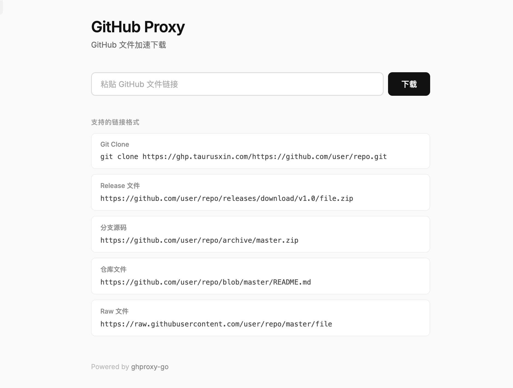

# ghproxy-go

[](https://github.com/taurusxin/ghproxy-go/releases)
[](https://hub.docker.com/r/taurusxin/ghproxy-go)

[](LICENSE)

High-performance GitHub Reverse Proxy service written in Go. Supports file acceleration for Release, Archive, Blob, and Raw files, as well as Git Clone operations.

Re-implementation of [hunshcn/gh-proxy](https://github.com/hunshcn/gh-proxy) in Go with a modernized UI and improved performance.



## Features

- **🚀 High Performance**: Built with Go + Gin, supports streaming transfer for large files.
- **📦 Static Binary**: Single binary distribution, no dependencies.
- **🐳 Docker Ready**: Multi-arch Docker images (amd64/arm64) based on Alpine.
- **🖥️ Modern UI**: Minimalist homepage with live link detection and copyable commands.
- **🔗 Smart Proxy**:
  - Release & Archive files
  - Blob & Raw files (automatic blob->raw conversion)
  - `git clone` support (Smart HTTP protocol)
  - `gist.github.com` support
  - Prefix-free URLs for `git clone`, Release, Archive, Blob, and Raw downloads

## Usage

### Web Interface

Visit the homepage (default `http://127.0.0.1:8972`) and paste a GitHub repository or
file URL. Commands appear immediately as you type:

- Repository URLs (with or without `.git`) produce a `git clone` command.
- Release, Archive, Blob, Raw, and Gist file URLs produce `wget` and `curl` commands.
- Copy a command with one click, or use **下载文件** to download a file directly.

Generated links use the current deployment's origin. Existing proxy links,
`github.com/owner/repo`, `owner/repo`, and `git@github.com:owner/repo.git` repository
addresses are also recognised and converted to HTTP clone URLs.

### Command Line

Prefix any GitHub URL with your proxy address:

```bash
# Download Release
wget https://example.com/https://github.com/taurusxin/ghproxy-go/releases/download/v1.0.0/app.zip

# Clone Repository
git clone https://example.com/https://github.com/taurusxin/ghproxy-go.git
```

### Prefix-free URLs

For `git clone` and GitHub file downloads, replace `github.com` with your proxy
domain. Both prefix-free and full-form links remain supported. Blob links are
automatically converted to raw file downloads.

```bash
# Clone Repository
git clone https://example.com/taurusxin/ghproxy-go.git

# Download Release
wget https://example.com/taurusxin/ghproxy-go/releases/download/v1.0.0/app.zip

# Download Archive
wget https://example.com/taurusxin/ghproxy-go/archive/refs/heads/main.zip

# Download a repository file (Blob or Raw URL)
curl -fL -o README.md https://example.com/taurusxin/ghproxy-go/blob/main/README.md
```

Links hosted on `raw.githubusercontent.com`, `raw.github.com`,
`gist.githubusercontent.com`, or `gist.github.com` retain the full URL prefix
so the proxy can identify the upstream host. Issue, pull request, and directory
pages are not file download links.

## Deployment

### Docker (Recommended)

```bash
docker run -d \
  --name ghproxy \
  -p 8972:8972 \
  --restart always \
  taurusxin/ghproxy-go:latest
```

### Docker Compose

```yaml
version: '3'
services:
  ghproxy:
    image: taurusxin/ghproxy-go:latest
    ports:
      - "8972:8972"
    restart: always
    environment:
      - HOST=0.0.0.0
      - PORT=8972
```

### Manual Installation

Download the latest binary from [Releases](https://github.com/taurusxin/ghproxy-go/releases).

```bash
# Linux / macOS
chmod +x ghproxy-go
./ghproxy-go

# Windows
ghproxy-go.exe
```

### Build from Source

```bash
git clone https://github.com/taurusxin/ghproxy-go.git
cd ghproxy-go
go build -o ghproxy-go .
./ghproxy-go
```

### Project Structure

```text
main.go                       # Embedded homepage and service entry point
internal/config/config.go     # Environment configuration and listen address
internal/server/server.go     # HTTP router and homepage handler
internal/proxy/target.go      # URL validation, normalisation, and Blob conversion
internal/proxy/proxy.go       # Proxy handler, redirects, and streaming
templates/index.html          # Homepage, live detection, and command generation
```

Run backend checks with `go test ./...` and `go vet ./...`. Frontend behaviour
tests use Node.js's built-in test runner: `node --test frontend_test.cjs`.
Use `go run .` to start from source so all packages are included.

## Configuration

Configuration is done via environment variables:

| Variable | Default   | Description          |
|----------|-----------|----------------------|
| `HOST`   | `0.0.0.0` | Listening address    |
| `PORT`   | `8972`    | Listening port       |
| `GIN_MODE`| `release` | Gin framework mode   |

## License

MIT
